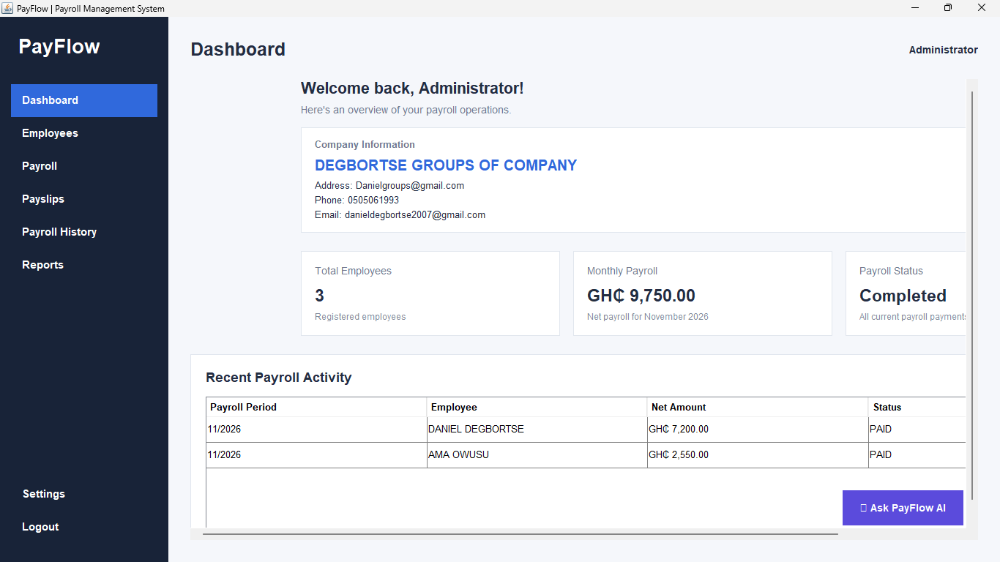
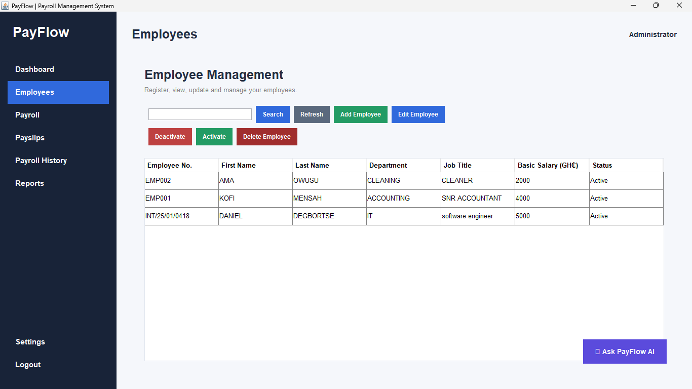
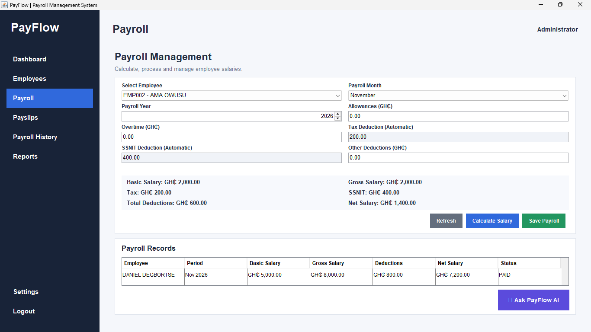
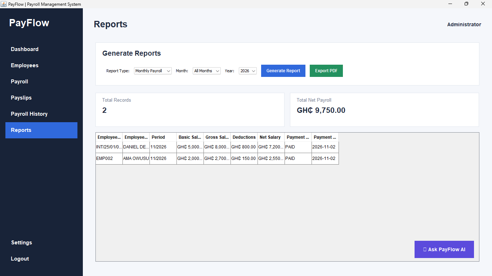

# PayFlow – Payroll Management System

**PayFlow** is a Java-based desktop payroll management application designed to simplify employee management, payroll processing, and salary record keeping.

## Features

- **Administrator Authentication:** Secure administrator account creation and login.
- **Employee Management:** Add, view, manage, and delete employee records.
- **Payroll Processing:** Calculate gross salary, tax, SSNIT, other deductions, and net salary.
- **Payroll History:** View and search previous payroll records.
- **Payslip Generation:** Preview, print, and export payslips as PDF files.
- **Reports:** Generate payroll summaries and export reports as PDF.
- **Application Settings:** Configure company details and payroll rates.
- **Payroll Insights:** View payroll summaries and automated rule-based insights.

## Technologies Used

- Java 24
- Java Swing
- Maven
- SQLite
- Apache PDFBox
- Bouncy Castle
- JUnit 5

## Requirements

- Java Development Kit (JDK) 24 or compatible version.
- Apache Maven.
- Visual Studio Code or another Java IDE.

## How to Run

1. Clone this repository.
2. Open the project folder in VS Code or a terminal.
3. Compile the application:

   ```bash
   mvn clean compile
   ```

4. Run the application:

   ```bash
   mvn exec:java "-Dexec.mainClass=com.payflow.Main"
   ```

5. On first launch, create an administrator account.

## Database

PayFlow uses SQLite for local data storage. The database is created automatically in the user's home directory under `.payflow`.

## Security

Administrator passwords are hashed using PBKDF2 with a random salt. Keep API keys and other secrets outside the source code.

## Project Status

PayFlow is an ongoing software development project.

## Developer

Developed as a Java payroll management project.

## Application Screenshots

### 1. Dashboard


### 2. Employee Management


### 3. Payroll Processing


### 4. Payroll Reports

